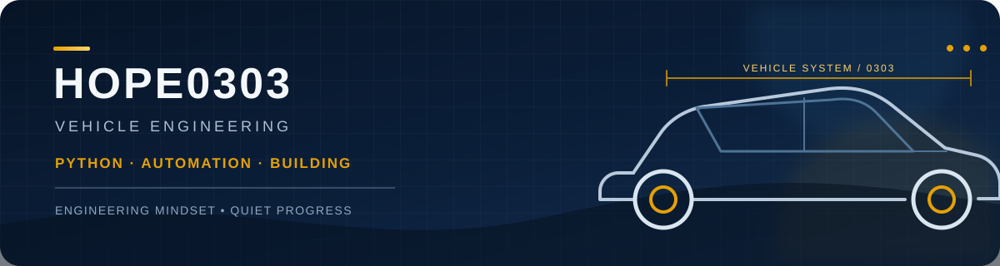

  

 

  
  
  
  

## 👋 关于我

你好，我是 **hope0303**，车辆工程专业，正在学习如何把工程思维与编程结合起来。

- 🚗 学习车辆工程相关专业知识
- 🐍 使用 Python 记录想法、处理问题并构建小工具
- ⚙️ 对自动化、工程计算和实用项目感兴趣
- 📚 坚持学习、动手实践，也把过程整理成可以复用的内容

> Learning, building, and sharing.

## 🔧 当前关注

| 方向 | 正在做的事 |
| --- | --- |
| 车辆工程 | 巩固专业基础，关注车辆结构、底盘与工程设计 |
| Python | 学习基础语法、数据处理与实用脚本 |
| 自动化 | 尝试把重复任务变成简单、可靠的工具 |
| 开源记录 | 用 README 和示例代码沉淀学习过程 |

## 📌 精选项目

### [Pythoncoder](https://github.com/hope0303/Pythoncoder)

面向 Python 初学者的基础教程与练习资料整理，涵盖语法、数据类型、流程控制、函数、标准库和数据库入门等内容。

**Python · Learning Notes · Beginner Friendly**

## 🌱 接下来

- 将 Python 用到车辆工程学习和工程数据处理中
- 完成更多可运行、可复现的小项目
- 持续完善项目文档，让代码更容易理解和使用

## 📫 联系与关注

- GitHub：[@hope0303](https://github.com/hope0303)

  保持好奇，认真做事，慢慢把想法变成作品。

